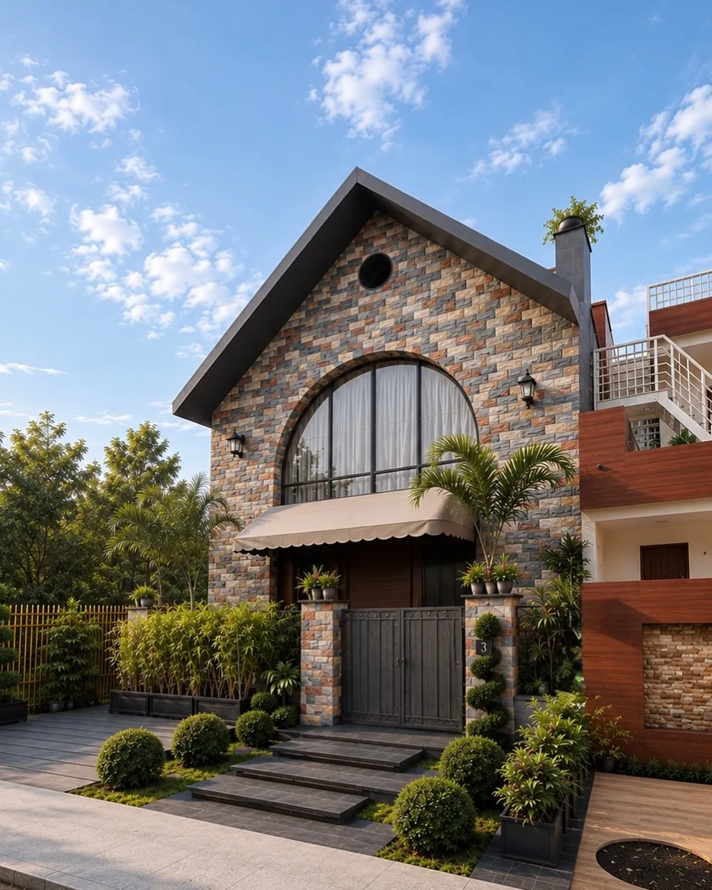
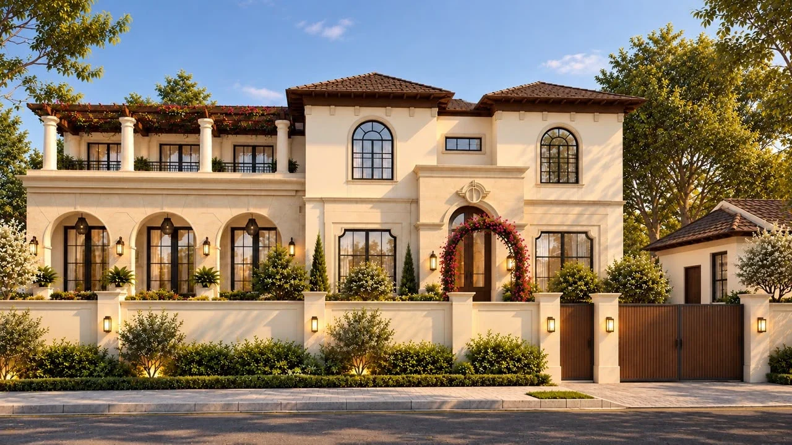

# GS Associates: Website Case Study

**A photo-led website for a Ludhiana architecture, construction and interiors firm, built around one idea: design, build and interiors by one team.**

| | |
|---|---|
| **Client** | GS Associates, Ludhiana |
| **Studio** | [WebX Studio](https://www.thewebxstudio.com/) |
| **Scope** | Design, front-end development, content structure, on-page SEO |
| **Timeline** | October to November 2026 |
| **Stack** | HTML, CSS, vanilla JavaScript, three.js, Python page generators |
| **Preview** | [gsa-seven.vercel.app](https://gsa-seven.vercel.app) |



## The challenge

GS Associates covers the whole journey of a building, from the first drawing to the finished interior. The website had to make that clear quickly and let the work do the selling.

The client's brief came down to four requirements:

- **Mostly white pages**, with project images as the focus
- **Big, bold type** that readers from 10 to 80 can read comfortably
- **Interactive moments** that feel engaging without getting in the way
- **A minimal, premium and professional feel** throughout

## The approach

### Lead with the promise

The home page opens on "Designing. Building. Transforming." over a building that rises through the sky and clouds as you scroll. The line beneath it says what the firm does and why that matters: architecture, construction and interiors, all under one roof.

### Show how an idea becomes a building

The centrepiece is an interactive 3D section that walks visitors through five stages: **Plan → Structure → MEP → 3D model → Reality**.

An illustrative villa draws itself from a floor plan, rises floor by floor, gains its electrical, plumbing and air-conditioning runs, and becomes a white architectural model. The final camera lines up with the client's render of the finished home, so the model dissolves into it. Visitors can also rotate the model by mouse, touch or arrow keys.



### Let the images carry the page

Feedback rounds kept pushing the design in one direction: images of the work over abstract graphics. The closing call to action went from a dark blueprint panel to a full-width image of a home, and it stayed that way.

### Make enquiring easy

A short project brief form turns a visitor's choices into a ready-to-send WhatsApp or email message. There is no back end to run, and the enquiry reaches the team through channels they already use. Phone and WhatsApp stay within reach throughout the site.

## What we built

**21 pages**, sharing one design system:

| Section | Pages |
|---|---|
| Core | Home, About, Services, Contact, 404 |
| Services | Architecture, Construction, Interiors |
| Projects | Residential and Commercial listings, 6 project pages |
| Blog | Blog index, 4 articles |

Other features include:

- **Full-screen menu** at every screen size, with Projects and Services as dropdowns
- **Project pages** with a photo gallery, lightbox, highlights and a link to the next project
- **Blog articles** with a reading-progress timeline and topic filters
- **Team and process content** on the About and Services pages

## Under the hood

- **No framework and no build step.** The site is plain HTML, CSS and JavaScript, so it is light to host and also runs when `index.html` is opened directly from disk.
- **One source of truth for repeated content.** Python generators build the project and blog pages from data files, and refresh the phone menu across every page. Adding a project means adding a data entry and its photos, then re-running the script.
- **A trimmed three.js bundle.** It includes only what the 3D section needs and is loaded only when required.
- **SEO groundwork.** Every page has a keyword-led title and description. Open Graph tags, canonical links and a sitemap are generated by script.
- **Reduced-motion support.** Visitors who ask their device for less motion get a calmer version of the site.
- **Tested across screen sizes.** Pages were checked from 350 px to 1800 px wide for overflow, clipped text, broken images and script errors.

## Project structure

```text
├── *.html                  Site pages
├── css/style.css           Shared design system and page styles
├── js/
│   ├── main.js             Hero, menu, reveals, lightbox
│   ├── idea3d.js           Interactive 3D section
│   ├── brief.js            WhatsApp and email brief builder
│   └── vendor/             Trimmed three.js bundle
├── assets/                 Images and video
└── tools/
    ├── projects/           Project data and page generator
    ├── blog/               Blog data and page generator
    └── seo.py              Open Graph tags, canonical links, sitemap
```

## Run it locally

```bash
python3 -m http.server 5173
```

Then open <http://localhost:5173>.

To regenerate the project pages, blog pages and shared menus (requires Pillow):

```bash
python3 tools/blog/gen_blog.py
```

## Results

<!-- Fill in with real numbers after launch. -->

| Measure | Result |
|---|---|
| Lighthouse (mobile) | To be added |
| Enquiries since launch | To be added |
| Search visibility | To be added |

> "Client testimonial to be added." — GS Associates

---

Designed and developed by [WebX Studio](https://www.thewebxstudio.com/).
